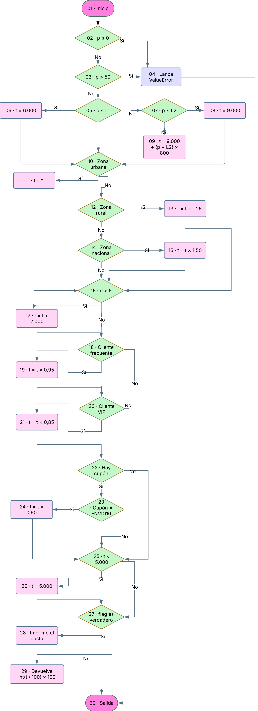
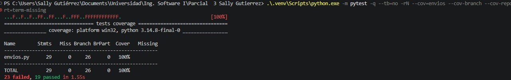
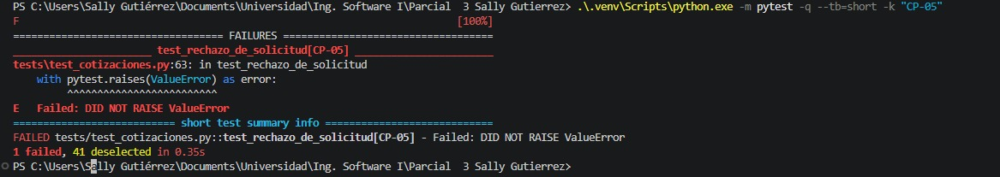
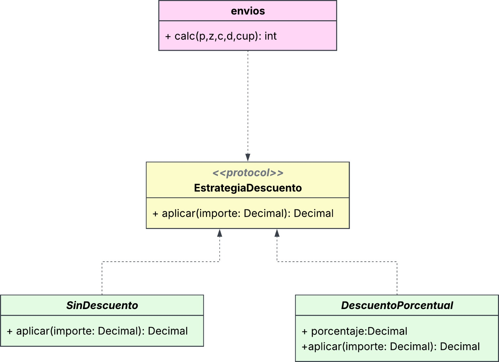
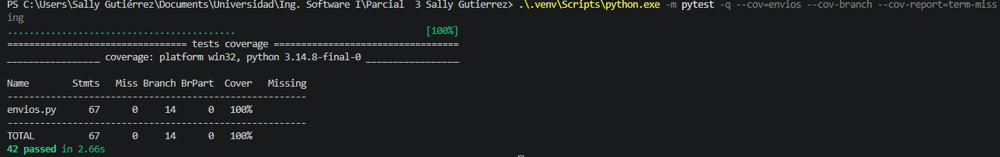

Nombre: Sally Andrea Gutiérrez Bermúdez

Código: 0182410075

## PARTE 1

### 1.

| A | B | C | D | E | F | PMAX | L1 | L2 | RR | RN | V | S | Cambio |
| --- | --- | --- | --- | --- | --- | --- | --- | --- | --- | --- | --- | --- | --- |
| 4 | 1 | 0 | 0 | 7 | 5 | 50kg | 3kg | 10kg | 25% | 50% | 15% | 2000 | 0 |

| ID | Regla (con tus valores) |
| --- | --- |
| R1 | El peso debe cumplir 0 < peso ≤ 50 kg. Si no, se lanza el error “peso inválido”. |
| R2 | Si la zona no es una de las tres válidas, o el día no está entre 1 y 7, se lanza un error. |
| R3 | Tarifa base. Tramo 1 (peso ≤ 3 kg): $6.000. Tramo 2 (hasta 10 kg, inclusive): $9.000. Más de 10 kg: $9.000 + $800 por cada kg sobre 10 kg, de forma proporcional. |
| R4 | Recargo por zona. Rural: +25 %. Nacional: +50 %. Urbana: sin recargo. |
| R5 | Fin de semana (sábado y domingo): +$2.000, después de los descuentos. |
| R6 | Descuento de cliente. Frecuente: 5 %. VIP: 15 %. Cupón ENVIO10: 10 %. Si hay los dos, se aplican ambos: primero el del cliente y luego el cupón. |
| R7 | El cupón es opcional. Si se proporciona un cupón desconocido, se devuelve un error. |
| R8 | El costo nunca es menor que $5.000. El resultado se redondea al múltiplo de $100 más cercano; los $50 redondean hacia arriba. |

### 2. Historias de Usuarios

**HU-01.** Detectar datos incorrectos antes de cotizar (R1, R2 y R7). Como operadora de EnvíaYa, quiero que el sistema valide los datos del envío y el cupón para saber qué debo corregir antes de informar un precio. **Dado** un envío nacional de 50 kg, para un cliente normal, el día 5 y sin cupón, **cuando** solicito la cotización, **entonces** el sistema acepta el peso y devuelve $61.500. **Dado** un envío urbano de 2 kg, para un cliente normal, el día 5 y sin cupón, **cuando** intento cotizarlo cambiando solo el peso a 50,1 kg, **entonces** se devuelve el error «peso inválido». Si en ese mismo envío cambio solo la zona a metropolitana o solo el día a 8, el sistema devuelve un error por el dato correspondiente. **Dado** que el envío tiene todos sus datos válidos pero incluye el cupón PROMO20, que no existe, **cuando** solicito el precio, **entonces** el sistema devuelve un error de cupón y la cotización queda sin total.

**HU-02.** Estimar el costo según el destino y el día de despacho (R3, R4 y R5). Como vendedora que prepara sus despachos, quiero cotizar cada paquete según su peso, su zona y el día de envío para estimar cuánto pagaré. **Dado** un paquete rural de exactamente 3 kg, para un cliente normal, el día 2 y sin cupón, **cuando** lo cotizo, **entonces** se aplica la base del primer tramo de $6.000 más el 25 % rural y se devuelve $7.500. **Dado** un envío urbano de 10,75 kg para un cliente normal, el día 2 y sin cupón, **cuando** lo cotizo, **entonces** se suman $600 por los 0,75 kg que exceden el límite de 10 kg y se devuelve $9.600. **Dado** un envío nacional de 5 kg para un cliente VIP, el domingo y sin cupón, cuando se calcula el total, **entonces** la base de $9.000 sube a $13.500 por la zona, baja a $11.475 por el descuento VIP y luego sube a $13.475 al sumar los $2.000 del domingo. El resultado redondeado es $13.500.

**HU-03.** Verificar los descuentos y el importe final (R6 y R8). Como cliente que usa descuentos, quiero que se apliquen mis beneficios en el orden previsto y que el total respete el mínimo y el redondeo establecidos. **Dado** un envío rural de 8 kg, para un cliente frecuente, el día 4 y con ENVIO10, **cuando** se calcula la cotización, **entonces** se aplica primero el 5 % sobre $11.250 y después el 10 % sobre el saldo. Los $9.618,75 resultantes se redondean a $9.600. **Dado** un envío urbano de 1,5 kg, para un cliente VIP, el día 4 y con ENVIO10, **cuando** los descuentos reducen el costo a $4.590, **entonces** se cobra el mínimo de $5.000. **Dado** un envío urbano de 6 kg, para un cliente VIP, el día 4 y sin cupón, **cuando** el descuento deja el costo en $7.650, **entonces** el empate se redondea hacia arriba y se devuelve $7.700.

### 3. Matriz de trazabilidad

Cada identificador CP enlaza un criterio de aceptación con el caso de prueba que lo verifica.

| Requisito | Historia | Casos de prueba |
| --- | --- | --- |
| R1 · Peso válido | HU-01 | CP-01: 50 kg aceptados. CP-02: 50,1 kg rechazados. |
| R2 · Zona y día válidos | HU-01 | CP-03: zona «metropolitana» rechazada. CP-04: día 8 rechazado. |
| R3 · Tarifa por peso | HU-02 | CP-06: 3 kg en el primer tramo. CP-08: 5 kg en el segundo. CP-07: 10,75 kg con cobro proporcional. |
| R4 · Recargo por zona | HU-02 | CP-06: rural +25 %. CP-07: urbana sin recargo. CP-08: nacional +50 %. |
| R5 · Fin de semana | HU-02 | CP-08: el domingo se suman $2.000 después del descuento VIP. |
| R6 · Descuentos | HU-02, HU-03 | CP-08: VIP, 15 %. CP-09: frecuente, 5 %, y luego ENVIO10, 10 %. |
| R7 · Cupón desconocido | HU-01 | CP-05: PROMO20 genera un error y la cotización queda sin total. |
| R8 · Mínimo y redondeo | HU-03 | CP-10: $4.590 se ajustan al mínimo de $5.000. CP-11: $7.650 suben a $7.700. |

## Parte 2. Plan de pruebas

### 2.1 Objetivo y alcance

Comprobar que cada solicitud de cotización produzca el importe previsto o el error definido en R1–R8. Se priorizarán los límites de peso, la validación de datos y cupones, y la aplicación de los descuentos antes del recargo de sábado y domingo. La primera ejecución se hará sobre `v1.0.0` y servirá de referencia para la regresión.

### 2.2 Niveles de prueba

**Unidad.** Probar comportamientos puntuales de `calc` con entradas controladas. Por ejemplo, verificar que un peso de 50,1 kg se rechace y que un envío urbano de 10,75 kg sin descuentos cueste $9.600.

**Integración.** Verificar que la validación del cupón y el cálculo de la cotización trabajen juntos. Con un envío válido, `ENVIO10` debe reducir el saldo después del descuento del cliente. Un cupón desconocido debe interrumpir el cálculo con un error.

**Sistema.** Ejecutar solicitudes completas mediante la función pública del cotizador. Usar como escenario un envío nacional VIP del domingo y comprobar que la cotización final sea $13.500.

**Aceptación.** Contrastar los resultados con HU-01 a HU-03. Verificar, entre otros criterios, que `PROMO20` genere un error, que un subtotal de $4.590 se ajuste a $5.000 y que $7.650 se redondeen a $7.700.

### 2.3 Estrategia, ambiente y roles

Construir una matriz con al menos 20 casos mediante particiones de equivalencia, valores límite y tabla de decisión. Desarrollar a mano al menos cinco resultados esperados y usar el grafo de `calc` para definir caminos de caja blanca. Ejecutar las pruebas automatizadas contra la versión heredada, registrar las diferencias y repetir la suite después de corregirlas.

**Ambiente.** Windows y PowerShell, Python 3 en un entorno virtual, pytest para ejecutar los casos, pytest-cov para medir cobertura y Git para identificar la versión probada.

**Roles.** Diseño: selecciona entradas y verifica los cálculos manuales. Ejecución: automatiza los casos y adjunta resultados y cobertura. Revisión: relaciona los defectos con los requisitos y comprueba las correcciones mediante regresión.

### 2.4 Riesgos y mitigaciones

Confundir cupón ausente con cupón desconocido. Mantener fijos el peso, la zona, el cliente y el día. Variar solo el cupón entre ausente, `ENVIO10` y `PROMO20`.

Que el mínimo o el redondeo oculten un error de cálculo. Incluir casos con subtotales por debajo del mínimo y casos que produzcan un empate exacto de $50.

Obtener resultados difíciles de reproducir. Registrar el commit, las versiones de herramientas y los comandos de ejecución junto con los resultados.

### 2.5 Criterios de entrada y salida

**Entrada.** Parámetros y reglas revisados, código heredado identificado con `v1.0.0`, entorno operativo y casos vinculados a los requisitos con resultados esperados definidos.

**Salida.** Matriz ejecutada, fallos iniciales documentados con pasos de reproducción y regresión aprobada. Archivar las capturas, la proporción de pruebas aprobadas, los defectos por severidad, la densidad de defectos y la cobertura de sentencias y de ramas. Comparar las coberturas de ambas ejecuciones.

## Parte 3. Diseño de casos de caja negra

El diseño usa la especificación R1–R8 y reúne 27 casos. Los resultados de la matriz son los valores esperados que se verificarán al ejecutar las pruebas.

### 3.1 Particiones de equivalencia

Se agrupan las entradas por el resultado que se espera de su validación o por el cálculo que activan. El cupón desconocido se considera inválido aunque el resto de la solicitud sea válido.

| Entrada | Clases válidas | Clases inválidas o tratamiento especial |
| --- | --- | --- |
| Peso (kg) | 0 < p ≤ 3; 3 < p ≤ 10; 10 < p ≤ 50. | p ≤ 0 y p > 50. Se devuelve «peso inválido». |
| Zona | Urbana, rural y nacional. Cada zona tiene un recargo distinto. | Zona fuera del catálogo. Se devuelve un error de zona. |
| Cliente | Normal, frecuente y VIP. Cada tipo tiene un descuento propio. | Tipo fuera del catálogo. La especificación no define qué respuesta debe producir. |
| Día | Enteros del 1 al 5, sábado (6) y domingo (7). | Entero menor que 1 o mayor que 7. Se devuelve un error de día. Los valores no enteros quedan fuera del dominio descrito. |
| Cupón | Ausente o ENVIO10. | Código desconocido. Se devuelve un error de cupón y la cotización queda sin total. |

### 3.2 Valores límite de peso

Se toman valores separados por 0,1 kg a cada lado de la frontera. El peso de 3 kg pertenece al primer tramo, 10 kg al segundo y 50 kg sigue siendo válido. Con 10,1 kg la base sube a \$9.080, por lo que el resultado urbano se redondea a \$9.100.

| Frontera | Inferior | Exacto | Superior |
| --- | --- | --- | --- |
| 0 kg | −0,1 kg · CP-12 | 0 kg · CP-13 | 0,1 kg · CP-14 |
| 3 kg (L1) | 2,9 kg · CP-15 | 3 kg · CP-06 | 3,1 kg · CP-16 |
| 10 kg (L2) | 9,9 kg · CP-17 | 10 kg · CP-18 | 10,1 kg · CP-19 |
| 50 kg (PMAX) | 49,9 kg · CP-20 | 50 kg · CP-01 | 50,1 kg · CP-27 |

### 3.3 Tabla de decisión

A es el importe después del recargo de zona. Cada combinación se evalúa para día hábil y fin de semana. Se aplica primero el descuento del cliente y luego el cupón sobre el saldo. Al final se suman \$2.000 si corresponde y se aplican el mínimo y el redondeo. Un cupón desconocido interrumpe la cotización.

| Cliente | Cupón | Días 1–5 | Días 6–7 |
| --- | --- | --- | --- |
| Normal | Ausente | A | A + \$2.000 |
| Normal | ENVIO10 | A × 0,90 | A × 0,90 + \$2.000 |
| Normal | Desconocido | Error de cupón | Error de cupón |
| Frecuente | Ausente | A × 0,95 | A × 0,95 + \$2.000 |
| Frecuente | ENVIO10 | A × 0,95 × 0,90 | A × 0,95 × 0,90 + \$2.000 |
| Frecuente | Desconocido | Error de cupón | Error de cupón |
| VIP | Ausente | A × 0,85 | A × 0,85 + \$2.000 |
| VIP | ENVIO10 | A × 0,85 × 0,90 | A × 0,85 × 0,90 + \$2.000 |
| VIP | Desconocido | Error de cupón | Error de cupón |

### 3.4 Matriz de casos de prueba

Las entradas aparecen como peso, zona, cliente, día y cupón. Los resultados corresponden a la especificación, y la técnica indica cómo se eligió cada caso. Los casos CP-05, CP-21 y CP-22 mantienen fijos los otros datos para aislar el efecto del cupón.

| ID | Requisito | Entradas | Resultado esperado | Técnica |
| --- | --- | --- | --- | --- |
| CP-01 | R1, R3, R4 | 50 kg · Nacional · Normal · día 5 · sin cupón | \$61.500 | Límite |
| CP-02 | R1 | 50,1 kg · Urbana · Normal · día 5 · sin cupón | Error «peso inválido» | Límite |
| CP-03 | R2 | 2 kg · «metropolitana» · Normal · día 5 · sin cupón | Error de zona | Partición |
| CP-04 | R2 | 2 kg · Urbana · Normal · día 8 · sin cupón | Error de día | Límite |
| CP-05 | R7 | 2 kg · Urbana · Normal · día 5 · PROMO20 | Error de cupón | Decisión |
| CP-06 | R3, R4 | 3 kg · Rural · Normal · día 2 · sin cupón | \$7.500 | Límite |
| CP-07 | R3, R4 | 10,75 kg · Urbana · Normal · día 2 · sin cupón | \$9.600 | Partición |
| CP-08 | R3–R6, R8 | 5 kg · Nacional · VIP · día 7 · sin cupón | \$13.500 | Decisión |
| CP-09 | R4, R6, R8 | 8 kg · Rural · Frecuente · día 4 · ENVIO10 | \$9.600 | Decisión |
| CP-10 | R6, R8 | 1,5 kg · Urbana · VIP · día 4 · ENVIO10 | \$5.000 | Decisión |
| CP-11 | R6, R8 | 6 kg · Urbana · VIP · día 4 · sin cupón | \$7.700 | Partición |
| CP-12 | R1 | -0,1 kg · Urbana · Normal · día 5 · sin cupón | Error «peso inválido» | Límite |
| CP-13 | R1 | 0 kg · Urbana · Normal · día 5 · sin cupón | Error «peso inválido» | Límite |
| CP-14 | R1, R3 | 0,1 kg · Urbana · Normal · día 5 · sin cupón | \$6.000 | Límite |
| CP-15 | R3, R4 | 2,9 kg · Rural · Normal · día 2 · sin cupón | \$7.500 | Límite |
| CP-16 | R3, R4, R8 | 3,1 kg · Rural · Normal · día 2 · sin cupón | \$11.300 | Límite |
| CP-17 | R3 | 9,9 kg · Urbana · Normal · día 2 · sin cupón | \$9.000 | Límite |
| CP-18 | R3 | 10 kg · Urbana · Normal · día 2 · sin cupón | \$9.000 | Límite |
| CP-19 | R3, R8 | 10,1 kg · Urbana · Normal · día 2 · sin cupón | \$9.100 | Límite |
| CP-20 | R1, R3, R4, R8 | 49,9 kg · Nacional · Normal · día 5 · sin cupón | \$61.400 | Límite |
| CP-21 | R7 | 2 kg · Urbana · Normal · día 5 · sin cupón | \$6.000 | Decisión |
| CP-22 | R6, R7 | 2 kg · Urbana · Normal · día 5 · ENVIO10 | \$5.400 | Decisión |
| CP-23 | R5, R6, R8 | 5 kg · Nacional · VIP · día 6 · sin cupón | \$13.500 | Decisión |
| CP-24 | R5, R6, R8 | 5 kg · Nacional · VIP · día 5 · sin cupón | \$11.500 | Decisión |
| CP-25 | R2 | 2 kg · Urbana · Normal · día 0 · sin cupón | Error de día | Límite |
| CP-26 | R2, R5 | 2 kg · Urbana · Normal · día 1 · sin cupón | \$6.000 | Límite |
| CP-27 | R1 | 50,1 kg · Nacional · Normal · día 5 · sin cupón | Error «peso inválido» | Límite |

### 3.5 Cálculo de resultados esperados

**CP-06.** Los 3 kg aún pertenecen al primer tramo. A la base de \$6.000 se suma el 25 % rural: \$6.000 + \$1.500 = \$7.500. El día 2 y el cliente normal no alteran el total. Se devuelven \$7.500.

**CP-07.** El envío supera en 0,75 kg el límite de 10 kg. El exceso cuesta 0,75 × \$800 = \$600. Se suma a la base de \$9.000. La zona urbana y la ausencia de descuentos mantienen el total en \$9.600.

**CP-08.** Base de \$9.000. Recargo nacional: \$9.000 + \$4.500 = \$13.500. Descuento VIP: \$13.500 − \$2.025 = \$11.475. Recargo del domingo: \$11.475 + \$2.000 = \$13.475. Al redondear se obtienen \$13.500.

**CP-09.** Base de \$9.000 y recargo rural de \$2.250: \$11.250. Descuento frecuente: \$11.250 × 0,95 = \$10.687,50. ENVIO10: \$10.687,50 × 0,90 = \$9.618,75. En día hábil, se redondea directamente a \$9.600.

**CP-10.** Base urbana de \$6.000. El descuento VIP deja \$5.100. El cupón reduce ese saldo en \$510, así que el subtotal es \$4.590. El mínimo lleva el resultado a \$5.000.

**CP-11.** La base urbana de 6 kg es \$9.000. El descuento VIP es \$1.350, por lo que el importe queda en \$7.650. Como la distancia a \$7.600 y a \$7.700 es de \$50, se elige \$7.700.

## Parte 4. Diseño de casos de caja blanca

### 4.1 Grafo de flujo

El diagrama representa la ejecución de `calc` en `v1.0.0`. Las decisiones aparecen en rombos y las acciones en rectángulos. El nodo 30 reúne la salida por excepción y la devolución del total.



*Figura 1. Grafo de flujo de calc en la versión heredada.*

### 4.2 Complejidad ciclomática

El grafo del código consta de 30 nodos y 43 aristas. El retorno y la excepción confluyen en la salida 30. Se comprobaron 14 nodos de decisión.

| Método | Cálculo | Resultado |
| --- | --- | --- |
| Aristas y nodos | V(G) = E − N + 2 = 43 − 30 + 2. El grafo tiene una entrada y una salida común. | 15 |
| Nodos predicado | V(G) = P + 1 = 14 + 1. La condición compuesta del peso se divide por cortocircuito en los nodos 02 y 03. | 15 |
| Regiones | 14 interiores y 1 exterior. Interiores por bloque: validación (2), tarifa (2), zona (3), fin de semana (1), cliente (2), cupón (2), mínimo (1) y flag (1). | 15 |

### 4.3 Caminos independientes y casos de prueba

La tabla contiene 15 recorridos independientes, verificados con sus vectores de aristas. Las referencias entre paréntesis reutilizan casos de caja negra. En cada recorrido se usa `flag=False`, salvo cuando la entrada indica `flag=True`. El resultado esperado se toma de la especificación y el observado se obtuvo ejecutando `v1.0.0`.

| Camino y referencia | Entradas y foco | Secuencia de nodos | Esperado | Observado en v1.0.0 |
| --- | --- | --- | --- | --- |
| CF-01 (CP-21) | Cotización de referencia. 2 kg · urbana · normal · día 5 · sin cupón. | 01 → 02 → 03 → 05 → 06 → 10 → 11 → 16 → 18 → 20 → 22 → 25 → 27 → 29 → 30 | \$6.000 | \$6.000 |
| CF-02 (CP-12) | Peso negativo. -0,1 kg · urbana · normal · día 5 · sin cupón. | 01 → 02 → 04 → 30 | Error «peso inválido» | ValueError «peso invalido» |
| CF-03 (CP-02) | Exceso del límite de peso. 50,1 kg · urbana · normal · día 5 · sin cupón. | 01 → 02 → 03 → 04 → 30 | Error «peso inválido» | ValueError «peso invalido» |
| CF-04 (CP-17) | Peso en tramo intermedio. 9,9 kg · urbana · normal · día 2 · sin cupón. | 01 → 02 → 03 → 05 → 07 → 08 → 10 → 11 → 16 → 18 → 20 → 22 → 25 → 27 → 29 → 30 | \$9.000 | \$9.000 |
| CF-05 (CP-19) | Peso con excedente. 10,1 kg · urbana · normal · día 2 · sin cupón. | 01 → 02 → 03 → 05 → 07 → 09 → 10 → 11 → 16 → 18 → 20 → 22 → 25 → 27 → 29 → 30 | \$9.100 | \$9.000 |
| CF-06 (CP-15) | Destino rural. 2,9 kg · rural · normal · día 2 · sin cupón. | 01 → 02 → 03 → 05 → 06 → 10 → 12 → 13 → 16 → 18 → 20 → 22 → 25 → 27 → 29 → 30 | \$7.500 | \$7.500 |
| CF-07 (CP-01) | Destino nacional. 50 kg · nacional · normal · día 5 · sin cupón. | 01 → 02 → 03 → 05 → 07 → 09 → 10 → 12 → 14 → 15 → 16 → 18 → 20 → 22 → 25 → 27 → 29 → 30 | \$61.500 | \$61.500 |
| CF-08 (CP-03) | Zona desconocida. 2 kg · metropolitana · normal · día 5 · sin cupón. | 01 → 02 → 03 → 05 → 06 → 10 → 12 → 14 → 16 → 18 → 20 → 22 → 25 → 27 → 29 → 30 | Error de zona | \$6.000 |
| CF-09 (CP-08) | Recargo dominical con VIP. 5 kg · nacional · vip · día 7 · sin cupón. | 01 → 02 → 03 → 05 → 07 → 08 → 10 → 12 → 14 → 15 → 16 → 17 → 18 → 20 → 21 → 22 → 25 → 27 → 29 → 30 | \$13.500 | \$13.100 |
| CF-10 | Beneficio de cliente frecuente. 8 kg · rural · frecuente · día 4 · sin cupón. | 01 → 02 → 03 → 05 → 07 → 08 → 10 → 12 → 13 → 16 → 18 → 19 → 20 → 22 → 25 → 27 → 29 → 30 | \$10.700 | \$10.600 |
| CF-11 (CP-11) | Beneficio VIP y empate. 6 kg · urbana · vip · día 4 · sin cupón. | 01 → 02 → 03 → 05 → 07 → 08 → 10 → 11 → 16 → 18 → 20 → 21 → 22 → 25 → 27 → 29 → 30 | \$7.700 | \$7.600 |
| CF-12 (CP-05) | Rechazo de cupón desconocido. 2 kg · urbana · normal · día 5 · PROMO20. | 01 → 02 → 03 → 05 → 06 → 10 → 11 → 16 → 18 → 20 → 22 → 23 → 25 → 27 → 29 → 30 | Error de cupón | \$6.000 |
| CF-13 (CP-22) | Cupón autorizado. 2 kg · urbana · normal · día 5 · ENVIO10. | 01 → 02 → 03 → 05 → 06 → 10 → 11 → 16 → 18 → 20 → 22 → 23 → 24 → 25 → 27 → 29 → 30 | \$5.400 | \$5.400 |
| CF-14 (CP-10) | Límite mínimo de cobro. 1,5 kg · urbana · vip · día 4 · ENVIO10. | 01 → 02 → 03 → 05 → 06 → 10 → 11 → 16 → 18 → 20 → 21 → 22 → 23 → 24 → 25 → 26 → 27 → 29 → 30 | \$5.000 | \$5.000 |
| CF-15 | Rama de impresión. 10 kg · urbana · normal · día 2 · sin cupón · flag=True. | 01 → 02 → 03 → 05 → 07 → 08 → 10 → 11 → 16 → 18 → 20 → 22 → 25 → 27 → 28 → 29 → 30 | \$9.000 y una impresión de diagnóstico | \$9.000 e imprime «costo: 9000» |

En CF-12, la ejecución pasa por los nodos 22 y 23 y omite el descuento del cupón. Devuelve \$6.000, aunque R7 exige un error. CF-15 verifica la salida de diagnóstico del argumento `flag`. Las demás diferencias observadas se conservan como evidencia para la ejecución de la suite.

### 4.4 Cobertura de sentencias y ramas

**Sentencias.** CF-02, CF-05, CF-09, CF-10, CF-14, CF-15 recorren conjuntamente todos los nodos ejecutables de `calc` en el grafo. Este conjunto incluye las dos formas de salir de la función: la instrucción que lanza el error de peso y el retorno normal. También alcanza la impresión de diagnóstico.

**Ramas.** La suite completa CF-01 a CF-15 recorre las 43 aristas del grafo. La tabla identifica un caso que toma cada salida Sí y No de los 14 predicados. Esta es la cobertura prevista por el diseño. En la Parte 5 se registrará la medición de la herramienta.

| Nodo predicado | Salida Sí | Salida No |
| --- | --- | --- |
| 02 · p ≤ 0 | CF-02 | CF-01 |
| 03 · p > 50 | CF-03 | CF-01 |
| 05 · p ≤ L1 | CF-01 | CF-04 |
| 07 · p ≤ L2 | CF-04 | CF-05 |
| 10 · Zona urbana | CF-01 | CF-06 |
| 12 · Zona rural | CF-06 | CF-07 |
| 14 · Zona nacional | CF-07 | CF-08 |
| 16 · d > 6 | CF-09 | CF-01 |
| 18 · Cliente frecuente | CF-10 | CF-01 |
| 20 · Cliente VIP | CF-09 | CF-01 |
| 22 · Hay cupón | CF-12 | CF-01 |
| 23 · Cupón = ENVIO10 | CF-13 | CF-12 |
| 25 · t < 5.000 | CF-14 | CF-01 |
| 27 · flag es verdadero | CF-15 | CF-01 |

## Parte 5. Automatización, ejecución y defectos

### 5.1 Pruebas automatizadas y entorno

El archivo tests/test_cotizaciones.py organiza los casos CP y CF en tres grupos: importes, rechazos y diagnóstico. Las pruebas de importe comparan el total esperado, las de validación comprueban ValueError y CF-15 verifica la salida de diagnóstico. Se ejecutaron los 42 casos sobre una copia de la versión heredada configurada.

Entorno de ejecución: Python 3.12.14, pytest 9.2.0, pytest-cov 7.1.0 y Coverage.py 7.17.2. Las figuras 2 y 3 corresponden a una repetición en el entorno virtual local con Python 3.14.8. Se obtuvieron los mismos totales y cobertura.

```powershell
python -m pytest -q --tb=short --cov=envios --cov-branch --cov-report=term-missing --cov-report=json:coverage.json
```



*Figura 2. Resultados y cobertura de la suite completa en el entorno virtual.*



*Figura 3. Ejecución aislada de CP-05. El código heredado no lanza el error esperado ante un cupón desconocido.*

### 5.2 Hallazgos y evidencia de reproducción

Los fallos de la suite se agruparon por causa. La prioridad P1 se asignó a cotizaciones que aceptan datos inválidos u omiten un recargo; P2 a errores de cálculo y P3 a discrepancias del mensaje. Cada ficha indica cómo reproducir el fallo en v1.0.0.

| Defecto | Requisito | Severidad / prioridad | Casos de referencia |
| --- | --- | --- | --- |
| DEF-01 · Se cotiza con un cupón que no existe | R7 | Alta / P1 | CP-05, CF-12 |
| DEF-02 · Una zona fuera del catálogo obtiene precio | R2 | Alta / P1 | CP-03, CF-08 |
| DEF-03 · Un día inexistente activa el recargo | R2 | Alta / P1 | CP-04, CP-25 |
| DEF-04 · Se omite el recargo del día 6 | R5 | Alta / P1 | CP-23 |
| DEF-05 · El descuento VIP afecta el recargo del domingo | R5 | Media / P2 | CP-08, CF-09 |
| DEF-06 · Se pierde el incremento en un empate de redondeo | R8 | Media / P2 | CP-11, CF-11 |
| DEF-07 · Texto de la excepción difiere del criterio | R1 | Baja / P3 | CP-12, CF-02 |

#### DEF-01 · Se cotiza con un cupón que no existe

Reproducción. Solicitar una cotización de 2 kg, urbana, cliente normal, día 5, con PROMO20. Esperado: Error de cupón y solicitud sin total. Obtenido: \$6.000. Justificación: El cupón desconocido no activa una excepción en las líneas 32–34. El rechazo es una condición explícita de R7.

#### DEF-02 · Una zona fuera del catálogo obtiene precio

Reproducción. Ingresar 2 kg, «metropolitana», cliente normal, día 5 y cupón ausente. Esperado: Error de zona. Obtenido: \$6.000. Justificación: La falta de una salida de error tras las zonas reconocidas (líneas 19–24) permite continuar con una solicitud inválida.

#### DEF-03 · Un día inexistente activa el recargo

Reproducción. Ingresar 2 kg, urbana, cliente normal, día 8 y cupón ausente. Esperado: Error de día. Obtenido: \$8.000. Justificación: El valor 8 pasa la condición d > 6 de la línea 26. Se emite un total a partir de un día inválido.

#### DEF-04 · Se omite el recargo del día 6

Reproducción. Cotizar 5 kg, zona nacional, cliente VIP, día 6 y cupón ausente. Esperado: \$13.500. Obtenido: \$11.400. Justificación: El sábado no pasa la condición de la línea 26. Al redondear correctamente el subtotal sin recargo, el total seguiría siendo solo \$11.500.

#### DEF-05 · El descuento VIP afecta el recargo del domingo

Reproducción. Cotizar 5 kg, zona nacional, cliente VIP, día 7 y cupón ausente. Esperado: \$13.500. Obtenido: \$13.100. Justificación: El código suma el recargo antes de descontar (líneas 26–31). El subtotal de \$13.175 daría \$13.200 con el redondeo correcto.

#### DEF-06 · Se pierde el incremento en un empate de redondeo

Reproducción. Cotizar 6 kg, zona urbana, cliente VIP, día 4 y cupón ausente. Esperado: \$7.700. Obtenido: \$7.600. Justificación: El subtotal queda en \$7.650 y la regla obliga a elegir el centenar superior. La conversión de la línea 39 elimina la fracción.

#### DEF-07 · Texto de la excepción difiere del criterio

Reproducción. Cotizar −0,1 kg, zona urbana, cliente normal, día 5 y cupón ausente. Esperado: ValueError con «peso inválido». Obtenido: ValueError con «peso invalido». Justificación: La validación detecta el peso inválido. La línea 12 difiere en la tilde del mensaje, con impacto limitado al texto de salida.

### 5.3 Resultados y métricas de calidad

| Métrica | Resultado | Base de cálculo |
| --- | --- | --- |
| Casos ejecutados | 42 | 27 de caja negra + 15 de caja blanca |
| Casos aprobados | 19 (45,24 %) | 19 ÷ 42 × 100 |
| Casos fallidos | 23 | Resultados que difieren de la especificación |
| Defectos por severidad | 4 altos, 2 medios, 1 bajo | Conteo de defectos únicos |
| Densidad de defectos | 18,92 por cada 100 líneas | 7 ÷ 37 × 100 |
| Cobertura de sentencias | 100 % | 29 de 29 sentencias medidas |
| Cobertura de ramas | 100 % | 26 de 26 ramas medidas |

La densidad se calculó sobre 37 líneas de envios.py, excluyendo comentarios y líneas vacías. pytest-cov midió 26 ramas entre líneas. El grafo de la Parte 4 muestra por separado las dos comparaciones del peso que están en una sola línea del código.

La cobertura completa permitió observar fallos de reglas de negocio en rutas que sí se ejecutaron. Los 23 casos fallidos constituyen la referencia para comprobar las correcciones posteriores.

## Parte 6. Mantenimiento y refactorización

### 6.1 Diagnóstico del diseño heredado

Las líneas corresponden a envios.py en la etiqueta v1.0.0.

| Mal olor | Líneas | Deuda técnica |
| --- | --- | --- |
| Responsabilidades mezcladas | 10–39 | La función decide validez, importes, promociones y salida de texto. Los cambios de una regla se revisan dentro del flujo completo. |
| Variables de propósito impreciso | 10 y 14–34 | t representa distintos subtotales a lo largo del cálculo. Los nombres cortos ocultan de qué etapa proviene cada importe. |
| Selección de comportamiento mediante condicionales | 28–34 | Cada tipo de cliente y promoción se maneja dentro de calc. Agregar descuentos aumenta las ramas que debe conocer el cotizador. |
| Literales de negocio dispersos | 11, 14, 16, 18, 29, 35 y 39 | Los valores usados por peso, tarifa, descuento y redondeo quedan incrustados entre decisiones. Revisarlos requiere recorrer todo el método. |
| Bandera que introduce un efecto lateral | 10, 37–38 | flag controla una impresión desde la función de cálculo y obliga a los llamadores a conocer una opción de diagnóstico. |
| Anidamiento del cupón | 32–34 | Comprobar el cupón y aplicarlo son pasos unidos al cálculo. La ruta de cupón desconocido queda sin tratamiento propio. |
| Asignación sin efecto | 20 | La reasignación de t en la zona urbana agrega trabajo de lectura sin cambiar el resultado. |

### 6.2 Intervenciones de mantenimiento

| Cambio | Tipo | Motivo |
| --- | --- | --- |
| DEF-01 | Correctivo | Se rechaza un cupón desconocido antes de calcular el importe. |
| DEF-02 y DEF-03 | Correctivo | Se validan el destino y el número de día antes de cotizar. |
| DEF-04 y DEF-05 | Correctivo | Se calcula un cargo para los días 6 y 7 y se suma al saldo después de ambos descuentos. |
| DEF-06 y DEF-07 | Correctivo | Se usa redondeo decimal a centenas con empate hacia arriba y se corrige el mensaje de peso. |
| Separar la validación y las etapas del cálculo | Perfectivo | Aísla responsabilidades y reduce la complejidad de calc. |
| Constantes con nombres | Preventivo | Centraliza las reglas de peso, tarifa y redondeo para reducir inconsistencias. |
| Estrategia de descuento | Preventivo | Permite cambiar la política de cliente o cupón en su propio componente. |
| Retiro de flag | Perfectivo | Simplifica la firma y elimina la impresión de diagnóstico del cotizador. |

### 6.3 Diseño de las estrategias de descuento

calc usa EstrategiaDescuento para aplicar primero la política del cliente y luego la política del cupón. SinDescuento conserva el importe. DescuentoPorcentual aplica la tasa de frecuente, VIP o ENVIO10 según el objeto seleccionado.



*Figura 4. Clases y protocolo de la estrategia de descuentos.*

### 6.4 Verificación de los cambios

La suite corregida aprobó 42 de 42 casos. Se conservaron las entradas, los IDs y los resultados esperados de negocio. CF-15 conserva el importe esperado y comprueba la ausencia del argumento flag y de la impresión. La evidencia del diagnóstico original permanece en la Parte 5.

La Figura 5 corresponde a la regresión repetida en el entorno virtual con Python 3.14.8. La captura muestra 67 sentencias y 14 ramas cubiertas. La tabla conserva la medición de referencia con Python 3.12.14, que registró 68 sentencias. Ambas ejecuciones aprobaron los 42 casos y obtuvieron 100 % de cobertura.



*Figura 5. Regresión de las cotizaciones en PowerShell. Los 42 casos aprueban con el código corregido.*

| Métrica | Código heredado | Código corregido |
| --- | --- | --- |
| Casos aprobados | 19 de 42 | 42 de 42 |
| Casos fallidos | 23 | 0 |
| Complejidad ciclomática de calc | 15 | 1 |
| Líneas físicas de envios.py | 39 | 106 |
| Líneas sin vacías ni comentarios | 37 | 79 |
| Cobertura de sentencias | 100 % · 29/29 | 100 % · 68/68 |
| Cobertura de ramas | 100 % · 26/26 | 100 % · 14/14 |

Las decisiones quedaron en funciones específicas. _peso_valido tiene complejidad 4 al contar el cortocircuito. _estrategia_cupon y _calcular_base tienen 3 cada una. El aumento de líneas corresponde a las etapas y clases extraídas. Coverage.py excluye cuatro líneas del protocolo en la versión corregida.
